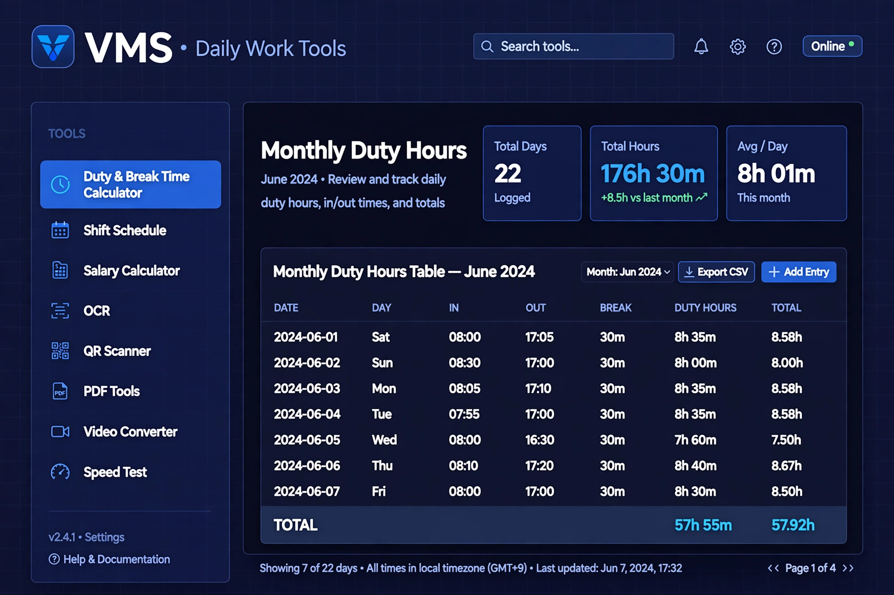

# VMS – Daily Work Tools

> **One Dashboard • All Essential Tools • Always Accessible**

A free, open-source, single-file dashboard for daily office work — duty hours, shift rosters, salary, OCR, QR, PDF, video and internet tools, all in one place. No install, no server, no account. Open `index.html` in a browser, or host it free on GitHub Pages.

[](LICENSE)
[](https://pages.github.com/)
[](#privacy)
[](#who-is-it-for)

**Live demo:** `https://iftakher-hridoy.github.io/nafi_it-daily-tools/`  



*Dashboard preview. Your live site uses the same dark navy grid design.*

---

## ✨ What it does

| Area | Tools inside |
|---|---|
| **Daily Office & Duty** | Monthly Duty & Break Time Calculator, Shift Schedule Generator, Salary & Hourly Rate Calculator |
| **Image & Documents** | Image to Text (OCR, English + Bangla), QR Code Scanner, QR Code Generator, PDF Tools |
| **Video & CCTV** | Video Format Converter, Video Compressor, Video Timestamp Calculator, Video Speed Controller |
| **Internet & Network** | Internet Speed Test, My IP & ISP Checker, Network Diagnostic Tools |
| **File Server** | NAFi iT File Server — Quick Access |
| **Other** | Date Calculator, Time Zone Converter, File Size Converter, Duplicate File Checker |

---

## 🧭 How it works

1. **Open the dashboard** — from GitHub Pages, or by double-clicking `index.html`.
2. **Pick a tool** from the left rail — for example, *Duty & Break Time Calculator*.
3. **Enter your times** — In/Out, break minutes, or a date range. Results update right away.
4. **Save / export** — duty entries are saved in your browser. Export the monthly total as CSV for Excel.
5. **Check today's duty** — add employees in the Shift Roster, generate the monthly roster, and *Today's Duty* shows who is on duty today, and at what time.

Everything runs in the browser. There is no server and no database to set up.

### Duty & Break Time Calculator

- Daily In/Out time, with multiple slots per day
- Break time calculation
- Net working hours per day
- Monthly total duty hours
- Late / overtime calculation
- CSV export for Excel

### Shift Schedule Generator

- Employee-wise duty schedule
- Day / Night shift
- Weekly off day
- Monthly roster
- **Today's Duty** — upload / enter the schedule, then check "what time is my duty today?"

### Salary & Hourly Rate Calculator

- Hourly rate × total hours
- Weekly / monthly salary
- Can pull hours straight from the duty log

---

## 👥 Who is it for?

- **Office staff & duty officers** — who log In/Out times every day and need a monthly total.
- **Shift workers & supervisors** — who need a monthly roster, weekly off days, and a quick "today's duty" check.
- **HR / admin teams** — who calculate salary from hours, and keep a simple, shareable record.
- **CCTV / video teams** — who convert and compress footage, and calculate incident times.
- **Anyone** — who wants OCR, QR, PDF, speed-test and time-zone tools without installing many apps.

---

## 🚀 Make it live on GitHub Pages

1. On GitHub, create a **new public repository** named `vms-daily-work-tools`.
2. Upload everything from this zip — `index.html`, `README.md`, `LICENSE`, `CONTRIBUTING.md`, and the `docs/` folder.
3. Go to **Settings → Pages**.
4. Under *Build and deployment*, choose **Deploy from a branch**, Branch: `main`, Folder: `/ (root)`, then **Save**.
5. Wait 1–2 minutes. Your site will be live at:

   `https://<your-username>.github.io/vms-daily-work-tools/`

### Use it locally (no GitHub needed)

Just double-click `index.html`. No build step, no `npm install`, no server.

---

## 🔒 Privacy

- Your files are processed **on your device** and are never uploaded by this site.
- Duty entries and roster data are saved in **your browser only** (local storage). They do not sync across devices in this static version.
- Internet tools (speed test, IP checker, DNS lookup) naturally contact public services to measure or look up your connection — that is how those tools work.

---

## 🛠 Tech

- Single self-contained `index.html` — HTML, CSS and JavaScript
- No build step, no backend
- Client-side engines loaded from CDN when needed: Tesseract.js (OCR), jsQR (QR scanning), pdf-lib / PDF.js (PDF), FFmpeg.wasm (video), Cloudflare speed endpoints
- Works best online, so those engines can load. If an engine cannot load, the tool shows an honest error message instead of failing silently.

> **Note on video conversion:** FFmpeg in the browser needs `SharedArrayBuffer`, which plain GitHub Pages may block. The Video Converter shows a warning about this on the page. All other tools work normally on GitHub Pages.

---

## 📁 Project structure

```text
vms-daily-work-tools/
├── index.html                  # The whole website — one file
├── README.md                   # This file — shown on the GitHub repo page
├── LICENSE                     # MIT License
├── CONTRIBUTING.md             # How to contribute
└── docs/
    └── screenshots/
        └── dashboard-preview.png
```

---

## 🤝 Contributing

Contributions are welcome — bug fixes, new tools, Bangla/English improvements, and better mobile layout.

1. Fork the repository.
2. Create a branch: `git checkout -b my-improvement`
3. Make your change in `index.html` (it is one file — please keep it that way).
4. Test it by opening `index.html` in a browser.
5. Open a Pull Request and describe what changed and why.

See [CONTRIBUTING.md](CONTRIBUTING.md) for the full guide.

---

## 📄 License

MIT License — see [LICENSE](LICENSE). Free to use, copy, modify and share, for personal or commercial work.

---

## 👤 Author

**iFTAKHER_HRiDOY** — built for daily duty, roster and office work.

*Made with NAFi-iT – Daily Work Tools. One Dashboard • All Essential Tools • Always Accessible.*
